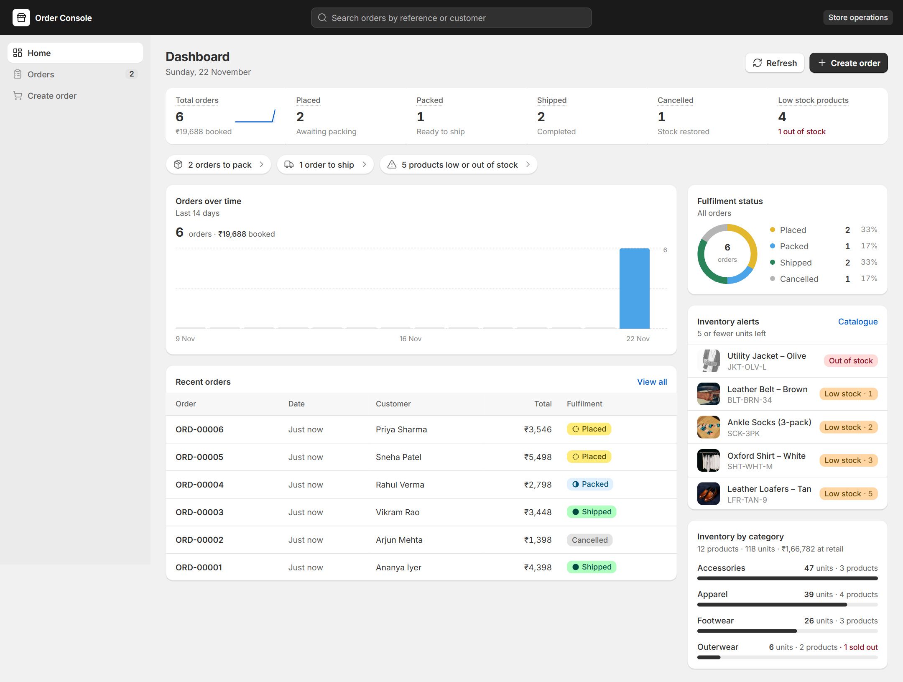
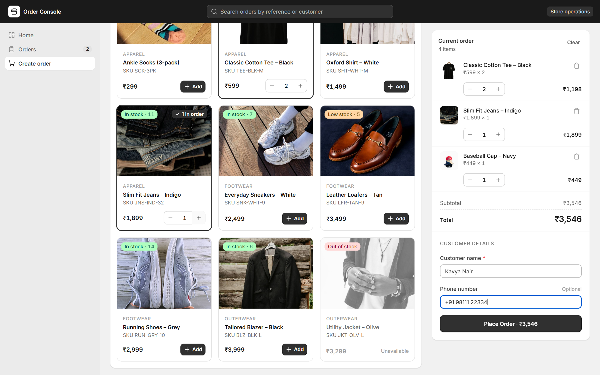
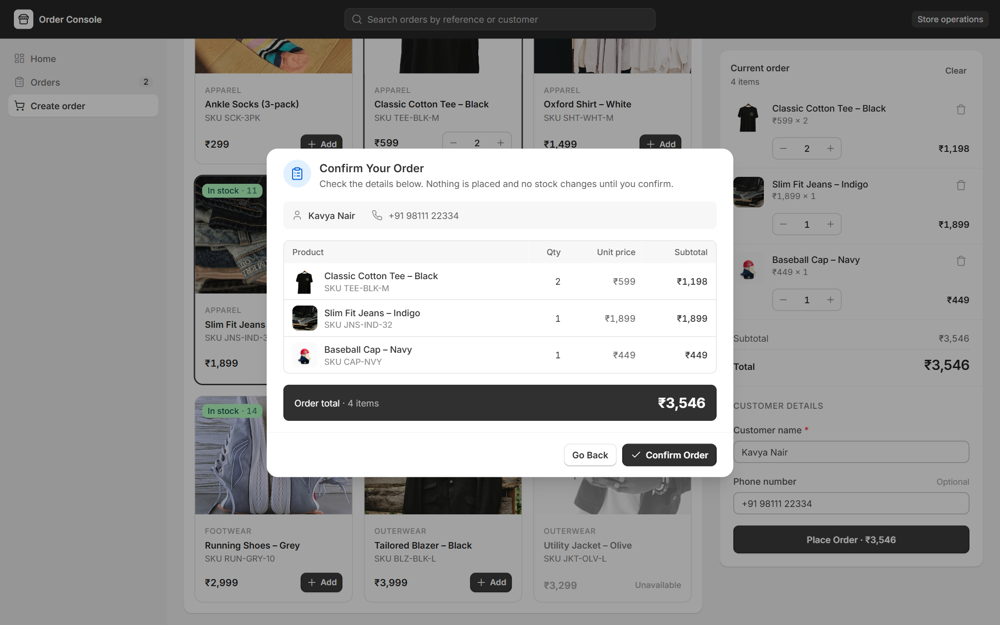
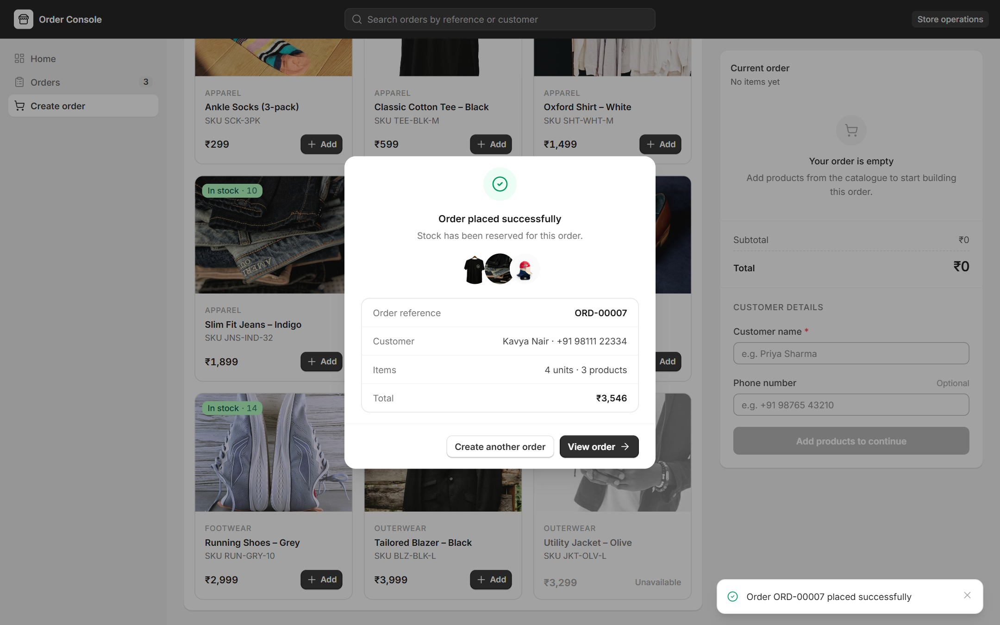
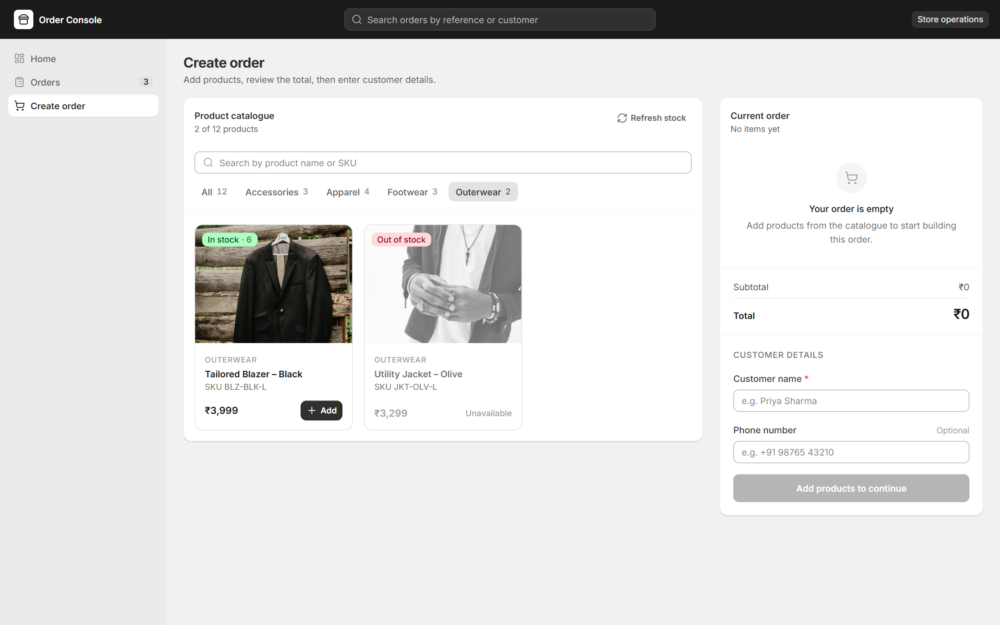
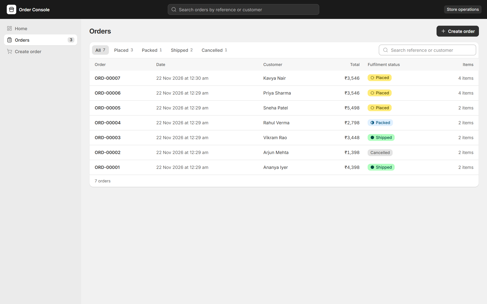
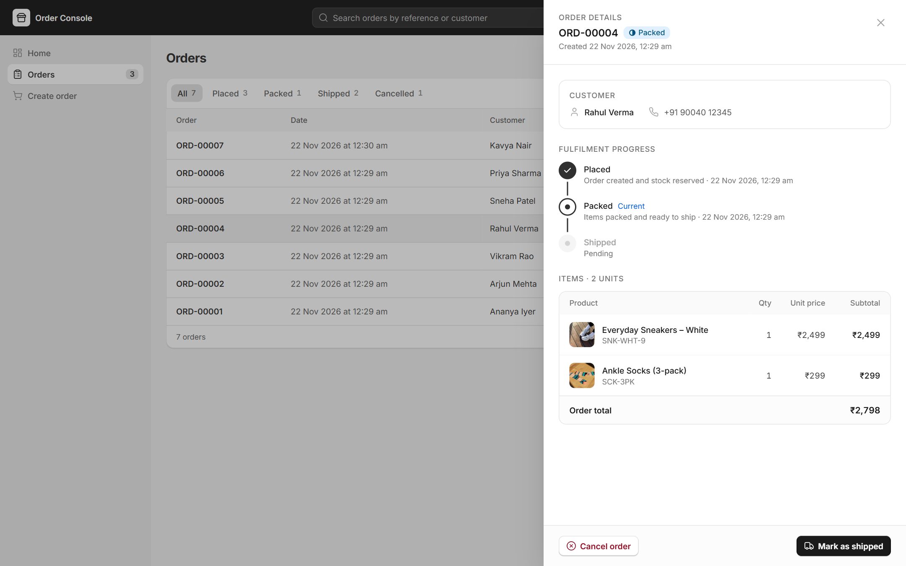
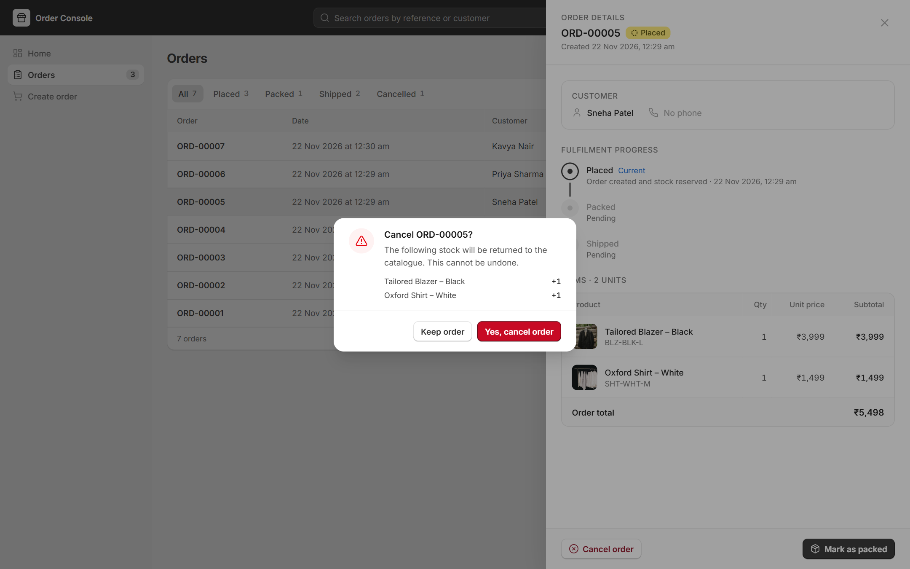

# Commerce Order Console

**Track:** Full Stack Developer (SDE 1) · **Use case:** Commerce Order Console

A browser-based console where store staff take phone orders, find them later, and move them through fulfilment. Stock can never be oversold, and cancellations return stock exactly once.

| Layer    | Tech                              | Why                                                                 |
| -------- | --------------------------------- | ------------------------------------------------------------------- |
| Frontend | React 18 + Vite, Tailwind CSS v4  | Fast dev loop, small bundle, consistent styling                     |
| Backend  | Node.js + Express                 | Simple JSON API; all business rules enforced here                   |
| Database | SQLite via `better-sqlite3`       | File-based persistence, real ACID transactions, zero setup          |
| Tests    | Jest + Supertest, Vitest + Testing Library | API tests against a real (in-memory) SQLite DB; UI tests for the order-confirmation flow |



---

## Quick start

Requires **Node.js 20+** and npm.

```bash
npm run setup   # installs root/server/client deps and seeds the catalogue
npm run dev     # API on :3001, UI on http://localhost:5173 (hot reload)
```

Other commands (all from the repo root):

| Command         | What it does                                                                   |
| --------------- | ------------------------------------------------------------------------------ |
| `npm test`      | Runs all automated tests: 30 API tests (Jest) and 6 UI tests (Vitest)          |
| `npm run seed`  | **Resets** the database: clears all orders and restores the catalogue          |
| `npm start`     | Builds the UI and serves UI + API from one process at http://localhost:3001    |

Data is stored in `server/data/orders.db`. Override it with `DB_PATH=/path/to/file.db`, and the port with `PORT`. If the database is empty on first boot, the server seeds it automatically.

### Seed catalogue

12 products in 4 categories. "Low stock" means 1–5 units left.

| SKU        | Product                      | Category    | Price     | Stock                |
| ---------- | ---------------------------- | ----------- | --------- | -------------------- |
| TEE-BLK-M  | Classic Cotton Tee – Black   | Apparel     | ₹599.00   | 25                   |
| JNS-IND-32 | Slim Fit Jeans – Indigo      | Apparel     | ₹1,899.00 | 12                   |
| SHT-WHT-M  | Oxford Shirt – White         | Apparel     | ₹1,499.00 | 4 (low)              |
| SCK-3PK    | Ankle Socks (3-pack)         | Apparel     | ₹299.00   | 3 (low)              |
| SNK-WHT-9  | Everyday Sneakers – White    | Footwear    | ₹2,499.00 | 8                    |
| RUN-GRY-10 | Running Shoes – Grey         | Footwear    | ₹2,999.00 | 15                   |
| LFR-TAN-9  | Leather Loafers – Tan        | Footwear    | ₹3,499.00 | 6                    |
| CAP-NVY    | Baseball Cap – Navy          | Accessories | ₹449.00   | 30                   |
| TOT-NAT    | Canvas Tote Bag – Natural    | Accessories | ₹699.00   | 18                   |
| BLT-BRN-34 | Leather Belt – Brown         | Accessories | ₹899.00   | 2 (low)              |
| JKT-OLV-L  | Utility Jacket – Olive       | Outerwear   | ₹3,299.00 | **0 (out of stock)** |
| BLZ-BLK-L  | Tailored Blazer – Black      | Outerwear   | ₹3,999.00 | 7                    |

Product photos are free Unsplash images stored in `client/public/products/<sku>.jpg` (sources in [`CREDITS.md`](client/public/products/CREDITS.md)). If a photo is missing, the UI falls back to a category icon.

Databases from earlier versions are upgraded automatically on startup. The `category` column is added, missing products are inserted, and renamed products are updated in place, without touching existing stock or orders.

---

## Features

**Dashboard.** A metrics row (total orders with a 14-day sparkline, Placed, Packed, Shipped, Cancelled, low-stock products), to-do shortcuts such as "2 orders to pack", an orders-over-time chart, recent orders, a fulfilment-status breakdown, inventory alerts and inventory by category. Every number comes from `GET /api/stats`, which queries the database on each request, and the dashboard refreshes after every order change. Each metric links to the matching filtered order list.

**1. Create orders.** A photo catalogue with search, a category filter, and in-stock / low-stock / out-of-stock badges. Staff add several products, adjust quantities (capped at available stock), review unit prices, subtotals and the live total, then enter the customer's name and an optional phone number. Out-of-stock items can't be added. **Place Order** opens a confirmation dialog first (see below).

**2. Find orders.** Search by order reference (`ORD-00012`, partial and case-insensitive) or customer name, either from the top bar on any page or on the Orders page, plus status tabs with counts. Clicking an order opens a side panel with customer details, a fulfilment timeline with timestamps, and every item with quantity, unit price, subtotal and the total.

**3. Manage fulfilment.** Only the next valid actions are shown (*Mark as packed*, *Mark as shipped*, *Cancel order*). The server enforces the state machine independently of the UI:

```
PLACED ──► PACKED ──► SHIPPED
   │          │
   └──► CANCELLED ◄──┘        (SHIPPED and CANCELLED are final)
```

**4. Keep data consistent.** See the next section.

**Order confirmation.** "Place Order" opens a **Confirm Your Order** dialog showing the customer, every product (SKU, quantity, unit price, subtotal) and the total. Nothing is sent and no stock changes until **Confirm Order** is clicked. **Go Back** returns to the cart with everything kept. While the request runs, the button shows "Placing Order…" and is locked, so extra clicks send nothing. If stock ran out in the meantime, the dialog shows exactly what is short, the cart stays as it was, and Confirm is blocked until the cart is adjusted.

**UI feedback.** Success and error toasts, inline error panels that list exactly which items were short and how many units are available, disabled buttons while a request is in flight, a confirmation before cancelling, and a stock refresh after every order attempt.

---

## How consistency is guaranteed

| Requirement | Implementation |
| --- | --- |
| Reject the whole order if any item is short, leave stock unchanged | Placement runs in one SQLite transaction. All lines are checked first. If any is short, the transaction throws and rolls back, so no stock moves and no order row is written. `better-sqlite3` transactions are synchronous, so no other request can interleave between the check and the deduction. |
| Never oversell | Besides the transaction, the deduction is `UPDATE … SET stock = stock - ? WHERE stock >= ?`, and the table has `CHECK (stock >= 0)` as a final safety net. |
| Restore stock exactly once on cancel | The status change is a compare-and-set (`UPDATE orders SET status='CANCELLED' WHERE id=? AND status=<current>`) in the same transaction as the stock restore. A repeated or concurrent cancel finds the order already `CANCELLED`, is rejected with `409`, and restores nothing. |
| Reject skipped or invalid transitions on the server | A single `TRANSITIONS` map in `server/src/orderService.js` is the source of truth. Anything outside it returns `409 INVALID_TRANSITION` with the allowed next states. |
| Survive restart | SQLite file on disk (WAL mode). Covered by a test that closes the DB, reopens it and reads the order back. |
| Double-clicked Submit | The UI sends an `Idempotency-Key` per order attempt. A repeat with the same key returns the original order (`200`, `Idempotent-Replayed: true`) instead of creating a second one. |
| Price changes later | Order lines snapshot the product name and unit price at the time of sale. |

Money is stored as integer **paise** to avoid floating-point rounding.

---

## API

| Method | Path                       | Body / query                                              | Notes |
| ------ | -------------------------- | --------------------------------------------------------- | ----- |
| GET    | `/api/products`            | –                                                         | Catalogue with category, stock and `stockStatus` |
| GET    | `/api/stats`               | –                                                         | Dashboard aggregates (live from DB) |
| GET    | `/api/orders`              | `?q=ORD-0001&status=PLACED`                               | Search and filter |
| GET    | `/api/orders/:idOrRef`     | –                                                         | Items, history, `allowedTransitions` |
| POST   | `/api/orders`              | `{ customerName, customerPhone?, items:[{productId, quantity}] }`, optional `Idempotency-Key` header | `201` created |
| POST   | `/api/orders/:id/status`   | `{ status: "PACKED" \| "SHIPPED" \| "CANCELLED" }`        | Server-enforced state machine |

Errors use one shape: `{ "error": { "code", "message", "details" } }`.

| Status | Codes |
| ------ | ----- |
| 400    | `BAD_JSON` |
| 404    | `ORDER_NOT_FOUND` |
| 409    | `INSUFFICIENT_STOCK`, `INVALID_TRANSITION`, `CONCURRENT_UPDATE` |
| 422    | `VALIDATION_ERROR`, `UNKNOWN_PRODUCT` |

---

## Tests

`npm test` runs 30 API-level tests in `server/tests/orders.test.js` (each with a fresh in-memory database) and 6 UI tests in `client/src/components/NewOrder.test.jsx` (Vitest + Testing Library, with only the network layer mocked). The UI tests cover: Place Order opens the dialog without calling the API, a missing customer name blocks it, Go Back keeps the cart and creates nothing, Confirm submits once and clears the cart, insufficient stock keeps the cart and blocks confirming, and double clicks send a single request that can be retried safely.

- **Successful placement**: stock is deducted, the total is correct, the status is `PLACED` and history is recorded.
- **Insufficient stock (acceptance example 1)**: A=5 and B=0; ordering 2×A + 1×B fails, A stays at 5 and no order is created.
- **Invalid state changes**: `PLACED → SHIPPED` (skip), `SHIPPED → CANCELLED`, `PACKED → PLACED` (backwards) and unknown statuses are all rejected.
- **Cancel exactly once (acceptance example 2)**: stock returns to 5, and a second cancel is rejected without changing stock.
- **Concurrency**: 10 simultaneous orders for 3 units give exactly 3 successes and stock ends at 0. 5 simultaneous cancels restore stock once.
- **Idempotency**: the same key sent twice gives one order and one stock deduction.
- **Validation**: empty or invalid quantities, a missing customer, a bad phone, unknown products and malformed JSON.
- **Search and filter**, including treating `%` and `_` literally.
- **Dashboard stats and migration**: stats match the real data, and a database from the earlier schema is upgraded with stock and orders intact.
- **Persistence**: the order and stock survive closing and reopening the database file.

---

## Walkthrough

The screenshots below come from a fresh install with demo orders created through the API.

**1. Build an order.** Open **Create order**, add Baseball Cap × 1, Classic Cotton Tee × 2 and Slim Fit Jeans × 1, and enter the customer's name. The cart shows unit prices, subtotals and the total.



**2. Review and confirm.** **Place Order** opens the confirmation dialog. No API call has happened yet. **Go Back** keeps the cart, and **Confirm Order** submits it.



**3. Order placed.** The server re-checks stock, prices the order from the database, deducts stock in one transaction and returns the reference.



**4. Out-of-stock items can't be added.** Utility Jacket has 0 units, so it is greyed out and marked *Unavailable*. The server rejects such an order anyway, with no stock changes.



**5. Find orders.** Use the status tabs or search by reference or customer.



**6. Fulfil.** Open an order to see its timeline. Only valid next actions are offered: here *Mark as shipped* and *Cancel order* for a packed order.



**7. Cancel.** Cancelling asks for confirmation and lists the stock that will be returned. Stock is restored exactly once, and a repeat cancel is rejected by the server.



---

## Project structure

```
server/
  src/db.js            schema + connection (SQLite, WAL, FK on)
  src/orderService.js  business rules: validation, placement, state machine, search
  src/app.js           Express routes + error handling (+ serves built UI)
  src/seed.js          synthetic catalogue; `npm run seed` resets data
  tests/               Jest + Supertest
client/
  src/App.jsx                     shell: top bar with order search, sidebar, hash routing
  src/components/Dashboard.jsx    metrics, to-dos, charts, alerts (from /api/stats)
  src/components/NewOrder.jsx     catalogue + cart + confirmation dialog
  src/components/NewOrder.test.jsx  UI tests for the confirmation flow
  src/components/Orders.jsx       list, search, status tabs
  src/components/OrderDetail.jsx  items, totals, timeline, fulfilment actions
  src/components/ui.jsx           shared components (badges, buttons, modals, toasts)
  public/products/                product photos (<sku>.jpg) + CREDITS.md
docs/screenshots/                 walkthrough screenshots
```

## Trade-offs and next steps

- No auth, payments or deployment, as the brief specifies.
- Idempotency keys don't check that a replayed request has the same body. A production version would store a hash of the request and reject a mismatch.
- SQLite fits a single store. For multiple instances I'd move to Postgres and use `SELECT … FOR UPDATE` or the same conditional `UPDATE` pattern.
- The list is capped at 500 rows. Pagination would be the next step.
